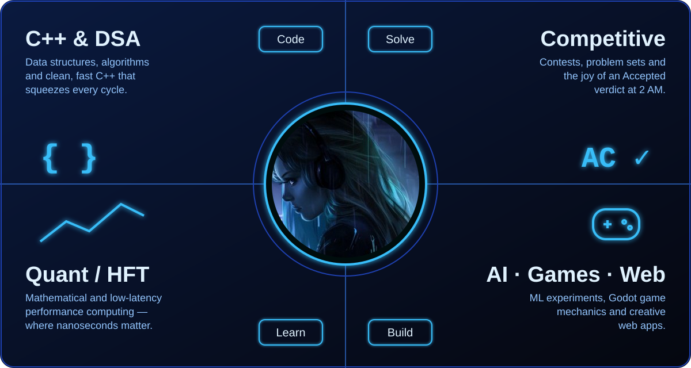

<div align="center">



<br/><br/>

<a href="https://github.com/Ayushizala10"></a>
<a href="https://www.linkedin.com/"></a>
<a href="#-about-me"></a>
<a href="#-featured-projects"></a>
<a href="#-lets-connect"></a>

<br/><br/>






<br/><br/>

<a href="https://git.io/typing-svg"></a>

</div>


## 💙 About Me

Hey! I'm **Ayushi Zala**, a Computer Science student who loves solving problems, building projects and exploring new technologies.

- 💻 C++ Developer and DSA enthusiast
- 🧩 Competitive Programming
- ⚡ Exploring Quantitative Computing and HFT
- 🤖 Interested in AI and Machine Learning
- 🎮 Game Development and Web Development
- 🌱 Exploring Open Source


## 💻 Tech Stack

<div align="center">

**Languages**


**Tools**


</div>


## 📊 GitHub Stats

<div align="center">


</div>


## 🎯 My Interests

| Area | What I explore |
|---|---|
| ⚡ Competitive Programming | DSA and algorithms |
| 📈 Quant / HFT | Mathematical and performance computing |
| 🤖 AI / ML | Machine learning |
| 🎮 Game Development | Game mechanics and systems |
| 🌐 Web Development | Creative applications |

## 🚀 Currently Working On

```cpp
struct Ayushi {
    std::vector<std::string> now = {
        "Improving my C++ and problem-solving skills",
        "Practising competitive programming",
        "Learning efficient programming techniques",
        "Building personal projects",
        "Exploring open-source contributions"
    };
};
```


## 📂 Featured Projects

More projects coming soon!

| Project | About |
|---|---|
| 🧠 **C++ DSA** | Algorithms and data structures |
| 🎮 **Game Development** | Interactive game projects |
| ⚙️ **Performance Lab** | C++ optimization experiments |
| 🤖 **ML Projects** | Machine learning experiments |


## 💙 Let's Connect

<div align="center">

[](https://github.com/Ayushizala10)
[](https://www.linkedin.com/)

<br/>

### 🦋 BUILD. LEARN. CONTRIBUTE.

*Dream big. Code harder. Build better.*


</div>
